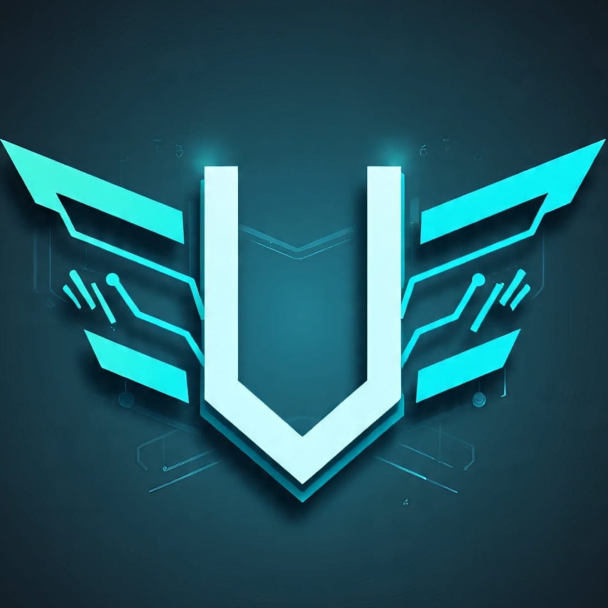

# 🏴‍☠️ Utopians CTF Team

<div align="center">



**Official website for the Utopians CTF Team from the University of Calcutta**

[](https://ctftime.org/team/408650)
[](https://nextjs.org/)
[](https://tailwindcss.com/)

[🌐 Visit Website](https://utopians.vercel.app) · [📊 CTFtime Profile](https://ctftime.org/team/408650) · [🎯 Join Us](#join-us)

</div>

---

## 🚀 About Us

**Utopians** is a passionate CTF (Capture The Flag) team based at the **University of Calcutta**, India. We compete in cybersecurity competitions worldwide, specializing in:

- 🔐 **Cryptography** - Breaking codes and understanding encryption
- 🌐 **Web Exploitation** - Finding vulnerabilities in web applications
- 🔧 **Reverse Engineering** - Analyzing and understanding compiled code
- 💻 **Binary Exploitation** - Pwning binaries and exploiting memory corruption
- 🔍 **OSINT** - Open Source Intelligence gathering
- 📟 **Forensics** - Digital forensics and memory analysis

## 👥 Team Members

| Name | Role | GitHub |
|------|------|--------|
| **Shaswata Saha** | Founder & Captain | [@subhro1530](https://github.com/subhro1530) |
| **Pratham Agarwal** | Co-Founder | [@UniquePratham](https://github.com/UniquePratham) |

## 🏆 Achievements

The site's numbers are **not hand-maintained** — they are pulled from the team's
CTFtime page and committed by a scheduled workflow, so they are always current.

| Season | Overall | Country (IN) | Events |
|---|---|---|---|
| 2026 | #354 · 209.000 pts | #38 | 71 |
| 2025 | #919 · 67.794 pts | #70 | 34 |

Best placement **#21** (Hack for a Change 2026 May: UN SDG 1) · highest score
**15,142** (CTF@CIT 2026) · **31** top-100 finishes across **105** events.

> View the full competition history on [CTFtime](https://ctftime.org/team/408650)

### How the stats stay current

```
scripts/sync-ctftime.mjs   fetch + parse the CTFtime team page
        ↓
data/ctf-data.json         105 events (name, place, points, rating, year)
data/ctf-team.json         team name, members, per-season ratings
        ↓
app/page.tsx               renders stats, cards and season labels from the JSON
```

`.github/workflows/sync-ctftime.yml` runs the script **daily at 06:17 UTC** and
commits only when something actually changed, so a new CTF appears on the site
within a day of its results being published — with no manual edit.

Run it yourself:

```bash
node scripts/sync-ctftime.mjs
```

The parser is defensive: a missing year, a missing table or a changed cell count
degrades to "no data" rather than throwing, so a CTFtime redesign cannot take
the site down. If the page structure changes enough that no seasons parse, the
script exits non-zero and the workflow fails loudly instead of committing an
empty file.

## 🛠️ Tech Stack

This website is built with modern technologies:

- **Framework:** [Next.js 16](https://nextjs.org/) with App Router
- **Styling:** [Tailwind CSS v4](https://tailwindcss.com/) with Lightwind theme
- **Animations:** [Framer Motion](https://www.framer.com/motion/)
- **Icons:** [Lucide React](https://lucide.dev/)
- **Font:** Geist Sans & Mono by Vercel
- **Deployment:** [Vercel](https://vercel.com/)

## 🚀 Getting Started

### Prerequisites

- Node.js 18+ 
- npm, yarn, pnpm, or bun

### Installation

```bash
# Clone the repository
git clone https://github.com/your-username/utopians.git
cd utopians

# Install dependencies
npm install

# Run development server
npm run dev
```

Open [http://localhost:3000](http://localhost:3000) to view the website.

### Build for Production

```bash
npm run build
npm start
```

## 📁 Project Structure

```
utopians/
├── app/
│   ├── page.tsx          # Main homepage
│   ├── layout.tsx        # Root layout with metadata
│   ├── actions.ts        # Server actions for form handling
│   └── globals.css       # Global styles & Tailwind config
├── components/
│   └── ui/
│       ├── Card.tsx      # 3D hover card component
│       ├── Navbar.tsx    # Navigation with mobile menu
│       ├── JoinForm.tsx  # Contact/join form
│       └── Footer.tsx    # Site footer
├── data/
│   └── ctf-data.json     # CTF competition data
├── public/
│   ├── team_logo.jpg     # Team logo
│   └── ctf-logos/        # CTF event logos
└── lib/
    └── utils.ts          # Utility functions
```

## 🎨 Design System

The website uses a custom **Lightwind** theme featuring:

- 🌊 **Primary:** Sky blue (#0ea5e9)
- ✨ **Glassmorphism:** Frosted glass effects
- 🎭 **3D Cards:** Interactive hover effects with depth
- 📱 **Responsive:** Mobile-first design

## 📬 Contact

Want to join the team or collaborate? Fill out the form on our website or reach out:

- **Email:** utopians.ctf@gmail.com
- **CTFtime:** [/team/408650](https://ctftime.org/team/408650)

## 📝 License

This project is open source and available under the [MIT License](LICENSE).

---

<div align="center">

**Made with 💙 by Utopians**

*"Breaking barriers, capturing flags"*

</div>
